# Голос сотрудника — MVP системы обратной связи и предложений

Рабочий MVP для трека хакатона ГК «Модус Трейд»: сотрудники сообщают о проблемах и предлагают улучшения, обращения автоматически попадают к ответственным, ход и результат рассмотрения фиксируются, а повторяющиеся темы видны руководителю.

- Продуктовая концепция: [docs/CONCEPT.md](docs/CONCEPT.md)
- Техническая концепция и архитектура: [docs/ARCHITECTURE.md](docs/ARCHITECTURE.md)
- Сценарий защиты на 5 минут: [docs/DEMO.md](docs/DEMO.md)
- Проверка с телефона: запустите `npm start`, подключите телефон к той же сети Wi-Fi и откройте `http://<IP компьютера>:3000` (Windows может спросить разрешение на доступ Node.js к сети).

| Подача с подсказкой похожих | Карточка обращения |
|---|---|
| 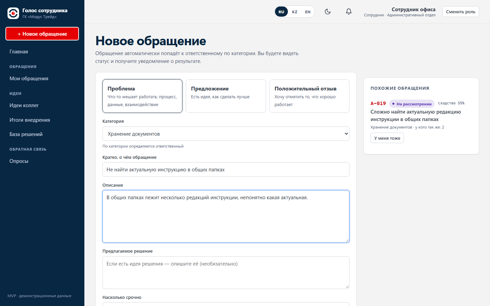 | 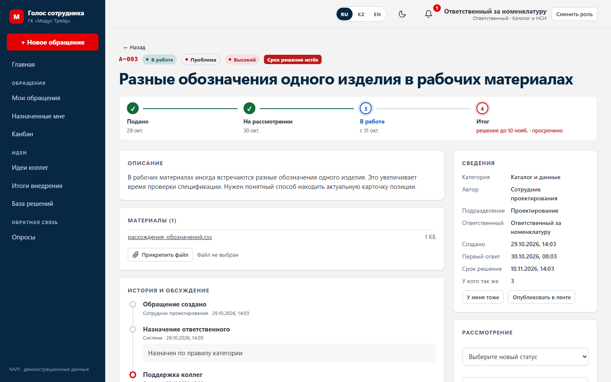 |

| Реестр | Аналитика |
|---|---|
| 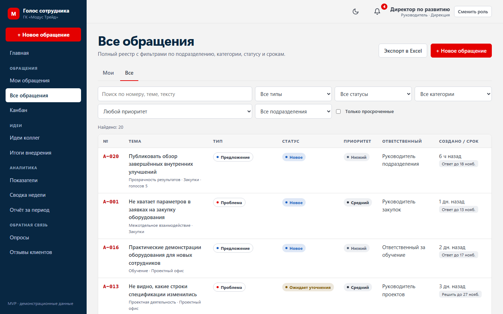 | 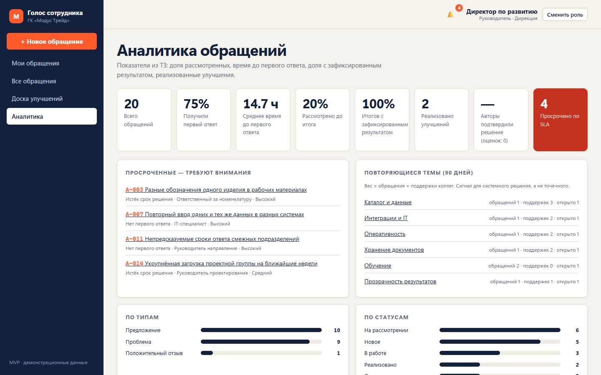 |

| Главная руководителя | Канбан |
|---|---|
| 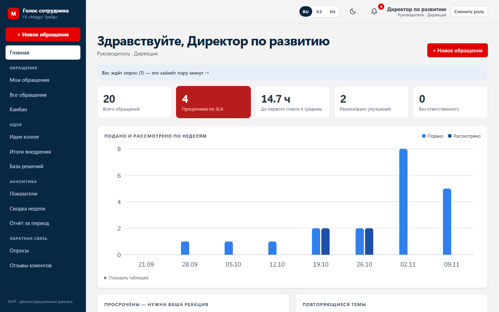 | 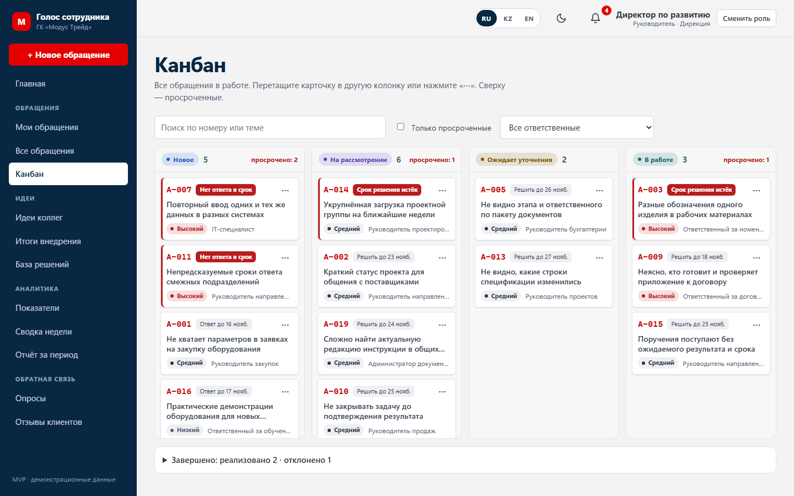 |

| Идеи коллег | Отчёт за период |
|---|---|
| 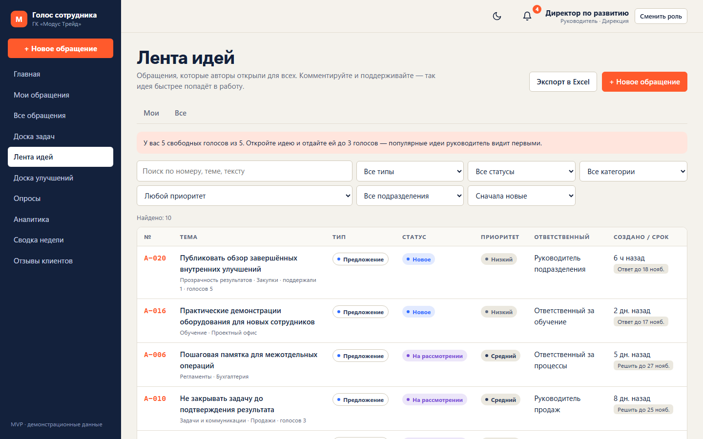 | 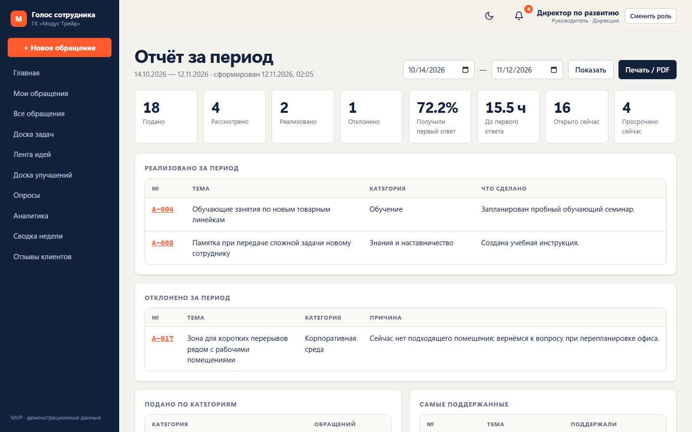 |

| Результаты опроса | Форма для клиента |
|---|---|
| 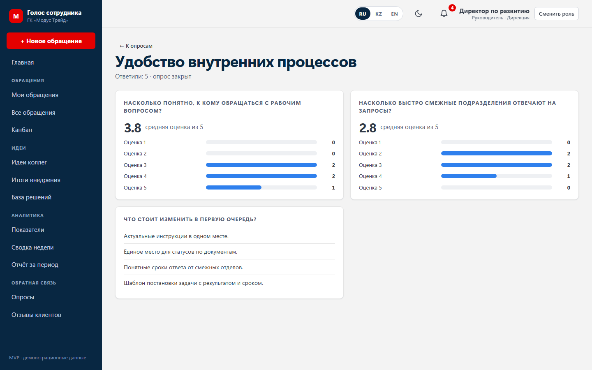 | 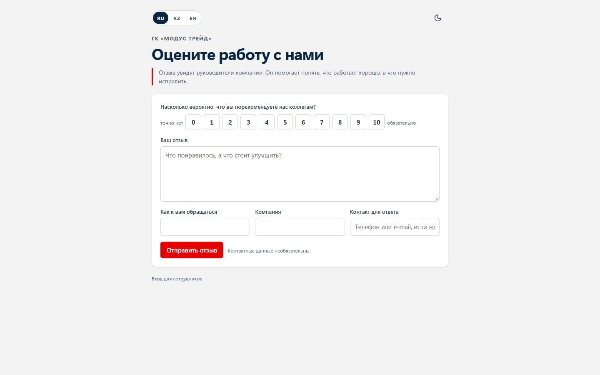 |

| База решений | Карта повторяющихся проблем |
|---|---|
| 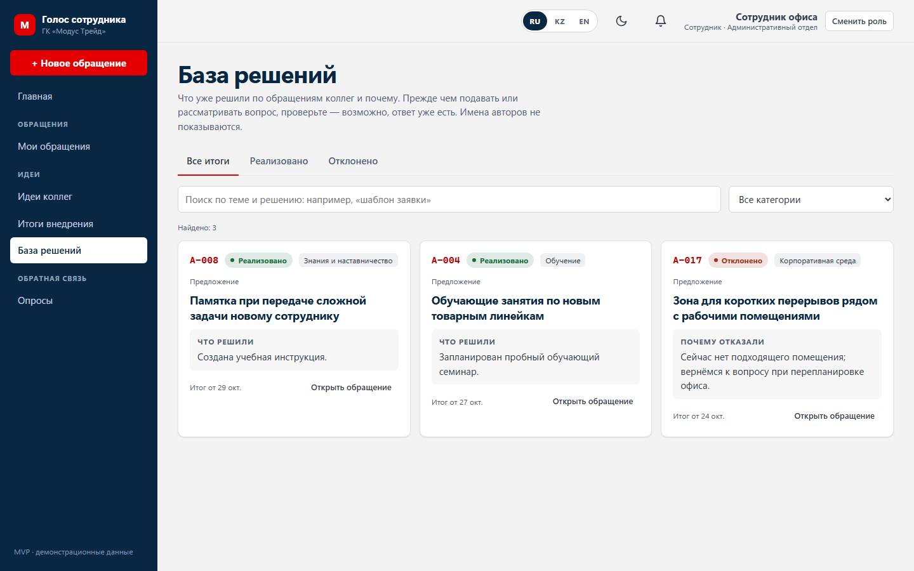 | 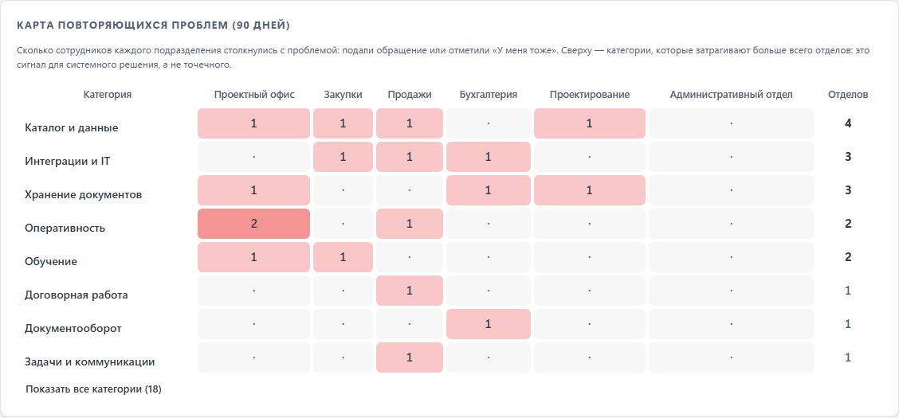 |

| Интеграции: оргструктура из Битрикс24 и 1С УТ | Задача в Битрикс24 из обращения |
|---|---|
| 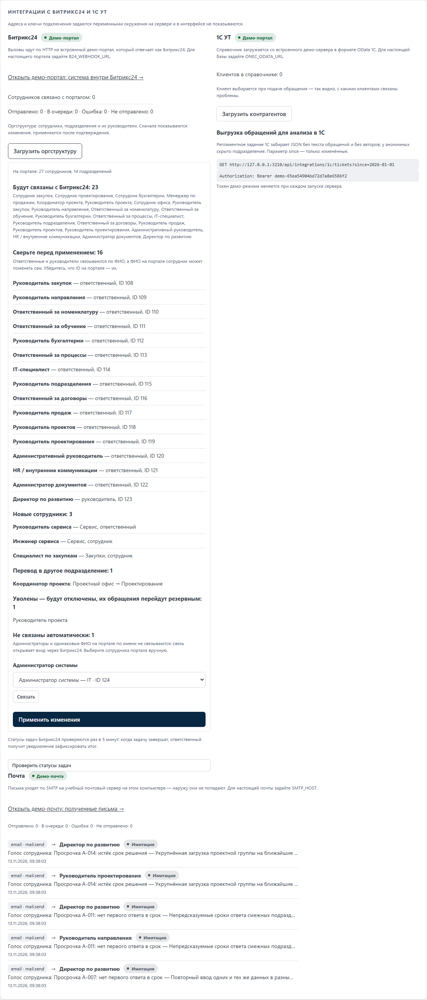 | 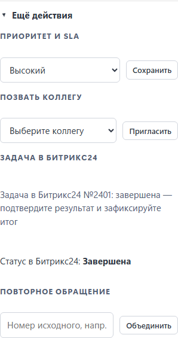 |

Тёмная тема:

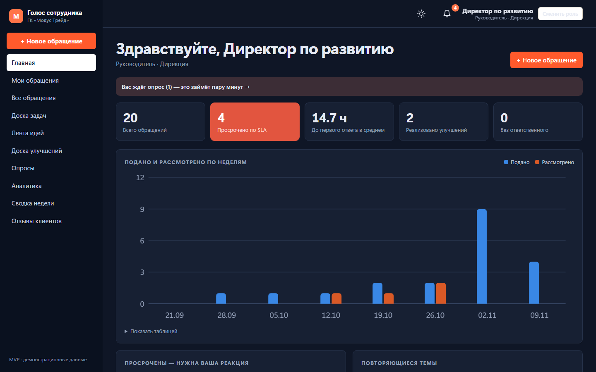

## Экраны и переходы

Основной путь обращения (ТЗ 2.3). Пунктиром показано, что видят другие роли.

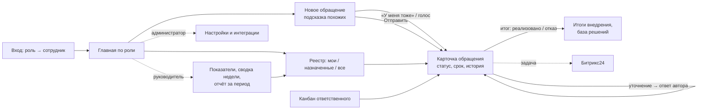

| Раздел меню | Кому виден | Куда ведёт дальше |
|---|---|---|
| Главная | всем | свои обращения и ожидаемые ответы, очередь ответственного или показатели руководителя → карточка |
| «+ Новое обращение» | всем | похожие обращения («У меня тоже», голос) или новая карточка |
| Мои / Назначенные мне / Все обращения, Канбан | по роли | карточка: статус, уточнение, итог, задача в Битрикс24 |
| Идеи коллег, Итоги внедрения, База решений | всем | опубликованные идеи с голосованием, реализованные улучшения, решения и отказы |
| Показатели, Сводка недели, Отчёт за период | руководителю и администратору | просрочки, карта проблем, клиенты → отфильтрованный реестр |
| Опросы, Отзывы клиентов | опросы — всем, отзывы — руководителю | ответы и сводные результаты |
| Настройки | администратору | категории и маршрутизация, пользователи, сроки, интеграции, журнал |

## Запуск

Требуется **Node.js 24+** (используются встроенные `node:sqlite` и `node:test`). Для запуска приложения внешних зависимостей нет — `npm install` не нужен (он требуется только для тестов интерфейса).

```bash
npm start
```

Откройте http://localhost:3000 и выберите роль на экране входа.

Внешние сервисы, интернет и ключи доступа для запуска не нужны: база и файлы хранятся локально. В демо-режиме интеграции с Битрикс24 и 1С УТ работают со встроенным демо-порталом — настоящими HTTP-запросами в форматах REST Битрикс24 и OData 1С. Подключение к настоящему порталу и базе 1С — переменными окружения (см. ниже).

| Команда | Что делает |
|---|---|
| `npm start` | запуск на порту 3000 (`PORT=8080 npm start` — другой порт) |
| `npm run reset` | удалить базу и вложения, заново загрузить демо-данные и запустить (то же самое — кнопка «Сбросить демо-данные» в «Настройках» администратора) |
| `node server.js` | запуск без демо-режима: кнопка сброса данных отключена. `npm start` и `npm run reset` включают демо-режим (`DEMO_MODE=1`), Docker-образ — нет |
| `npm test` | 195 серверных тестов с отчётом о покрытии |
| `npm install`, затем `npx playwright install chromium`, затем `npm run test:e2e` | 66 сквозных тестов интерфейса (Playwright) на отдельной чистой базе: сценарии, эмуляция телефона Android, автоматическая проверка доступности (axe-core, WCAG 2.1 AA) в светлой и тёмной теме |
| `npm run screenshots` | пересоздать снимки экранов в `docs/screenshots/` |
| `npm run voice`, затем `npm run video`, затем `npm run video:voice` | пересобрать видео защиты с озвучкой. `voice` — нейросетевой голос Microsoft (нужны `python -m pip install edge-tts` и интернет; текст реплик из `e2e/demo-voice.json` отправляется в облачный сервис синтеза), без интернета — `npm run voice:offline` (встроенный голос Windows, звучит заметно хуже). `video` записывает сценарий в темпе реплик, `video:voice` накладывает звук → `docs/demo/demo.webm` |

Подключение к системам компании (необязательно; без переменных в демо-режиме работает встроенный демо-портал, вне демо-режима — только журнал):

| Переменная | Что задаёт |
|---|---|
| `B24_WEBHOOK_URL` | входящий вебхук облачного Битрикс24 компании, например `https://<портал>.bitrix24.kz/rest/<id>/<ключ>/`; создаёт администратор портала («Разработчикам» → «Другое» → «Входящий вебхук») с правами `user`, `department`, `im`, `task`. Серверу нужен исходящий доступ к порталу по HTTPS |
| `B24_CLIENT_ID`, `B24_CLIENT_SECRET` | вход через Битрикс24: код и ключ локального приложения портала («Разработчикам» → «Другое» → «Локальное приложение», только серверная часть, путь обработчика `<PUBLIC_URL>/api/auth/b24/callback`, права `user`). Портал — тот же, что в `B24_WEBHOOK_URL`. Когда заданы, вход выбором из списка закрыт — даже при `DEMO_MODE=1` |
| `ONEC_ODATA_URL`, `ONEC_USER`, `ONEC_PASSWORD` | OData-интерфейс 1С УТ, например `http://<сервер>/<база>/odata/standard.odata/`; учётная запись только на чтение |
| `ONEC_EXPORT_TOKEN` | токен, с которым 1С забирает выгрузку `GET /api/integrations/1c/tickets` (заголовок `Authorization: Bearer …`) |
| `PUBLIC_URL` | адрес системы для ссылок в уведомлениях Битрикс24 — должен открываться у сотрудников (внутренний адрес, VPN или внешний). Если адрес начинается с `https://`, cookie сессии помечается `Secure` |

Рабочая установка:

| Переменная | Что задаёт |
|---|---|
| `DEMO_DATA=0` | не загружать демо-датасет: в пустой базе создаётся только администратор (имя — `ADMIN_NAME`), дальше — «Загрузить оргструктуру» из Битрикс24 или импорт CSV, категории и правила в «Настройках» |
| `ADMIN_B24_ID` | ID администратора в Битрикс24: администраторы по ФИО с порталом не связываются, поэтому без него при входе только через портал первый администратор не войдёт. Если база уже создана, ID дописывается первому администратору без связи с порталом |
| `TRUST_PROXY=1` | система стоит за своим HTTPS-прокси (nginx и т. п.): адрес пользователя для ограничения частоты запросов берётся из `X-Forwarded-For`. Без этого все пользователи выглядят одним адресом прокси и упираются в общий лимит входов |
| `COOKIE_SECURE=1` | cookie сессии только по HTTPS (включается и автоматически, если `PUBLIC_URL` на `https://`) |
| `MUTATIONS_PER_MINUTE` | лимит изменений в минуту на пользователя (по умолчанию 60) |

**Важно:** без `B24_CLIENT_ID` вход в системе — выбор пользователя без пароля, и такую установку можно размещать только во внутренней сети компании (или за VPN), не в открытом интернете. С входом через Битрикс24 выбор из списка закрыт: сотрудник входит учётной записью портала, система пароля не видит. Адрес системы — по HTTPS.

Запуск в контейнере (образ не собирался на машине разработки — Docker там не установлен):

```bash
docker build -t feedback-mvp . && docker run -p 3000:3000 -v feedback-data:/data feedback-mvp
```


База создаётся в `data/feedback.db` и при первом запуске заполняется 20 обращениями из «Датасет.docx». Даты строятся относительно момента запуска, поэтому просрочки SLA на демо всегда актуальны.

## Демо-сценарии (раздел 4 датасета)

| # | Сценарий | Как показать |
|---|---|---|
| 1 | Создать обращение, выбрать тип и категорию, приложить файл | Войти как **Сотрудник офиса** → «Новое обращение». При вводе текста справа появляются похожие обращения (например, напишите «не найти актуальную инструкцию в папках» — найдётся A-019) с кнопкой «Поддержать» |
| 2 | Назначить ответственного по категории; альтернатива при отсутствии | Ответственный назначается автоматически. **Администратор системы** → «Настройки» → снять «на месте» у «Администратор документов» и создать обращение в «Хранение документов» — назначится резервный («Ответственный за процессы»). Если нет и резервного (категория «Интеграции и IT» + отключить IT-специалиста) — руководитель-диспетчер |
| 3 | Изменить статус, запросить уточнение, история комментариев | Войти как ответственный (например, **Руководитель закупок**, A-001) → «Рассмотрение» → «Ожидает уточнения» с вопросом. Автор отвечает комментарием — обращение само возвращается «На рассмотрение». Есть внутренние заметки, невидимые автору (пример — A-003) |
| 4 | Показать автору состояние и итог, в т. ч. мотивированный отказ | **Сотрудник офиса** → A-017 «Отклонено» с причиной. Итоговые статусы нельзя поставить без зафиксированного результата |
| 5 | Фильтры по подразделению, категории, статусу, сроку; просроченные | **Директор по развитию** → «Все обращения» → фильтры и «Только просроченные» (A-003, A-007, A-011, A-014). Фильтры сохраняются в адресе страницы; «Экспорт в Excel» выгружает текущую выборку |
| 6 | Сводка: по типам, доля закрытых, среднее время первого ответа | **Директор по развитию** → «Аналитика»: KPI из ТЗ, просроченные, повторяющиеся темы, возможные дубликаты |

Дополнительно: «Итоги внедрения» (доступна всем) — реализованные предложения без имён авторов и открытые темы для поддержки; колокольчик — уведомления о назначении, смене статуса и комментариях.

## Что реализовано

- Подача обращений трёх типов (проблема / предложение / положительный отзыв) с категорией, приоритетом, предлагаемым решением и вложениями (до 5 МБ, белый список форматов).
- Анонимная подача: имя и подразделение автора скрыты от всех, включая руководителей; сам автор видит статус и получает ответы.
- Маршрутизация «основной → резервный → руководитель-диспетчер» с учётом доступности.
- Жизненный цикл из 7 статусов с проверкой допустимых переходов; обязательный результат для итоговых статусов.
- SLA по приоритету в рабочих днях (выходные не считаются), автоматическая фиксация первого ответа, подсветка просрочек.
- Эскалация: при просрочке ответственный и руководитель получают уведомление, в истории остаётся запись.
- Оценка результата автором («решён / не решён») и доля подтверждённых итогов в аналитике.
- Экспорт реестра в CSV для Excel с учётом прав и фильтров; постраничный вывод; фильтры в адресе страницы.
- Интеграция с Битрикс24 (ТЗ 1.2 — назначение ответственных и уведомления):
  - оргструктура: «Настройки» → «Загрузить оргструктуру» показывает, кто будет связан, добавлен, переведён и отключён, и применяет только после подтверждения; руководители отделов получают роль ответственного, уволенные отключаются, их обращения переходят резервным;
  - уведомления (`im.notify`) и задача из карточки (`tasks.task.add`) уходят на портал в фоне через журнал отправки: запись делается вместе с изменением, при ошибке — до 5 повторов с паузой, затем «Ошибка» и кнопка «Повторить»; номер задачи с портала появляется в истории обращения.
- Вход через Битрикс24: кнопка «Войти через Битрикс24» на экране входа → страница входа портала → сотрудник в системе со своей ролью. Сотрудник находится по ID Битрикс24 из оргструктуры; не связанный или отключённый видит понятное сообщение. В демо-режиме вход проходит через демо-портал (после «Загрузить оргструктуру»), выбор роли тоже остаётся.
- Интеграция с 1С УТ (ТЗ 1.2 — анализ обращений): справочник контрагентов по OData, выбор клиента при подаче и в карточке; выгрузка обращений для регламентного задания 1С по токену — без текста и авторов, у анонимных скрыто подразделение.
- Статусы задач Битрикс24: раз в 5 минут система проверяет задачи, созданные из обращений (`tasks.task.get`), и показывает статус в карточке. Когда задачу завершили, ответственный получает уведомление зафиксировать итог. В демо-режиме задачу можно завершить на демо-портале кнопкой в карточке.
- Аналитика по клиентам из 1С: на странице «Показатели» — клиенты с наибольшим числом обращений (всего, открыто, проблем, частая категория), по клику — реестр, отобранный по клиенту.
- Главная страница по ролям: сотруднику — его обращения и ожидаемые от него ответы, ответственному — очередь и ближайшие сроки, руководителю — показатели, просрочки и график.
- Графики динамики по неделям: подано и рассмотрено, время до первого ответа (с подсказками и табличным видом).
- Канбан с перетаскиванием и запросом результата или вопроса автору при перемещении.
- Шаблоны ответов, приглашение коллеги в обсуждение, подписка на обращение.
- Черновик нового обращения сохраняется в браузере и восстанавливается.
- Сроки SLA настраиваются администратором; праздничные дни 2026–2027 не считаются; о неустранённой просрочке напоминают каждые 2 рабочих дня.
- Светлая и тёмная тема.
- Идеи коллег: автор может открыть обращение для всех сотрудников — его читают, комментируют и поддерживают (для предложений включено по умолчанию).
- Отчёт о внедрении («что сделано» и «эффект») у реализованных обращений; рейтинг авторов принятых идей и «автор месяца» на «Итогах внедрения».
- Нагрузка по ответственным, среднее время в каждом статусе, отчёт за произвольный период с печатью в PDF.
- В настройках: шаблоны ответов, праздничные дни, пользователи и роли, журнал действий администратора.
- Опросы сотрудников с оценками 1–5 и открытыми вопросами; результаты сводные, доступны только после закрытия опроса и если ответивших не меньше трёх; закрытый опрос нельзя открыть заново.
- Форма отзыва для клиентов без входа в систему (адрес `/#/client`) и раздел руководителя с расчётом NPS.
- Вход в два шага: роль → человек; роль с одним пользователем входит сразу.
- Голосование за идеи: у каждого 5 голосов на открытые идеи из ленты, до 3 на одну; лента сортируется по популярности, голоса с рассмотренных идей возвращаются.
- Сводка недели для руководителя: изменения к прошлой неделе, просрочки, популярные идеи, готовый текст для рассылки.
- Подача с телефона: фото с камеры сжимается в браузере и прикрепляется к обращению.
- Приложение на телефоне: систему можно установить на главный экран (иконка, запуск без адресной строки, ярлык «Новое обращение»); без связи интерфейс открывается из сохранённой копии, плашка «Нет связи» напоминает, что черновик сохраняется на устройстве. Данные обращений на устройстве не хранятся. Работает по HTTPS — в рабочей установке; при открытии по `http://<IP>` в локальной сети сайт работает как обычно, без установки.
- Автопроверка на GitHub: каждый push в main и каждый PR прогоняет проверку переводов, серверные тесты и тесты интерфейса.
- Автор может исправить своё обращение, пока оно «Новое» или «Ожидает уточнения»; правка видна в истории.
- Фильтр реестра по дате подачи (вместе с фильтром просроченных).
- Импорт пользователей из CSV; при отключении обработчика его открытые обращения переходят следующему по правилу категории.
- Комментарии, внутренние заметки, запрос уточнения с автовозвратом на рассмотрение, полная история событий.
- Поиск похожих обращений, «У меня тоже» для проблем и голосование за идеи вместо дубликатов, объединение дубликатов.
- Роли и разграничение доступа: сотрудник / ответственный / руководитель / администратор.
- Аналитика по показателям ТЗ, «Итоги внедрения», внутренние уведомления, администрирование категорий и замещений.
- Цели показателей (ТЗ 2.7): администратор задаёт целевые значения, на странице «Показатели» каждая плитка показывает цель и достигнута ли она.
- Карта повторяющихся проблем: категории × подразделения за 90 дней — сколько сотрудников каждого отдела подали обращение или отметили «У меня тоже»; сверху категории, затронувшие больше всего отделов.
- База решений: рассмотренные обращения с итогом — что решили или почему отказали, с поиском, фильтром по категории и итогу, без имён авторов. При подаче похожее рассмотренное обращение показывает «Уже решено: …».
- Шкала этапов в карточке: Подано → На рассмотрении → В работе → Итог, с датами, сроком следующего шага и пометкой о просрочке.
- Три языка интерфейса — русский, казахский, английский: переключатель RU · KZ · EN в верхней панели и на экране входа, выбор запоминается в браузере. Переводятся меню, подписи, сообщения сервера, названия категорий, подразделений и демо-пользователей; текст обращений и комментариев остаётся на языке автора. Полноту словарей проверяет `npm run i18n:check` и серверный тест.

## Известные ограничения MVP

- **Вход через Битрикс24 проверен на демо-портале**, а не на портале компании. В демо-режиме для показа остаётся вход выбором роли без пароля; в рабочей установке с `B24_CLIENT_ID` он закрыт.
- **Интеграции проверены на демо-портале**, а не на портале и базе компании: форматы запросов взяты из документации REST Битрикс24 и OData 1С, перед пилотом нужно подключиться к настоящим системам (что уточнить — в [docs/ARCHITECTURE.md](docs/ARCHITECTURE.md)). Статусы задач опрашиваются раз в 5 минут, а не приходят событием: облачный портал шлёт события только на адрес, доступный из интернета. Без переменных окружения и вне демо-режима вызовы Битрикс24 только записываются в журнал.
- SLA учитывает выходные и праздники, но не часы работы; рабочая неделя считается по московскому времени. Праздники по умолчанию: 2026 год — с переносами, 2027 — ориентировочно. Администратор правит список в «Настройках»; перед пилотом его нужно сверить с производственным календарём.
- Поиск похожих — упрощённый стемминг и коэффициент Жаккара; для промышленной версии — полнотекстовый поиск или эмбеддинги.
- SQLite рассчитан на один экземпляр сервера; экспорт ограничен 5000 строк (файл и интерфейс об этом предупреждают).
- Черновик хранится только в текущем браузере. Установка на телефон и работа без связи требуют HTTPS.
- Форма для клиентов защищена только проверкой полей, полем-ловушкой и лимитами (5 отправок в минуту с одного адреса, 300 отзывов в сутки всего); для открытого интернета нужна капча и модерация.
- Опубликованное в ленте обращение видят все сотрудники вместе с ответами ответственного и вложениями. Автор и ответственный могут убрать его из ленты; служебное пишется во внутренних заметках.
- Анонимные обращения учитываются в сводной статистике по подразделениям — в очень малом отделе это косвенный признак.
- Нет e-mail/push-уведомлений.
- Сессия живёт 12 часов и проверяется на сервере, но продления при активности нет.

## Структура

```
server.js            точка входа
src/app.js           HTTP-сервер, статика, сессии, rate limit
src/routes.js        REST API (конверт { ok, data, error })
src/access.js        политика доступа по ролям
src/routing.js       маршрутизация обращений
src/tickets-*.js     чтение и изменение обращений, SLA
src/escalation.js    эскалация просрочек SLA и напоминания
src/settings.js      настраиваемые сроки SLA
src/collab.js        наблюдатели, приглашения, задача Битрикс24
src/integrations/    Битрикс24 и 1С УТ: настройки, HTTP-клиенты, доставка журнала, оргструктура, контрагенты, демо-портал
src/home.js          данные главной страницы
src/reports.js       отчёты о внедрении, рейтинг авторов
src/templates.js     шаблоны ответов
src/surveys.js       опросы сотрудников
src/client-feedback.js  отзывы клиентов и NPS
src/audit.js         журнал действий администратора
src/votes.js         голосование за идеи
src/digest.js        сводка недели
src/user-import.js   импорт пользователей из CSV
src/demo-reset.js    сброс демо-данных
src/export.js        экспорт реестра в CSV
src/analytics.js     показатели и повторяющиеся темы
src/similarity.js    поиск похожих обращений
src/seed*.js         демо-данные из датасета
public/              интерфейс (ES-модули без сборки)
test/                серверные тесты node:test
e2e/                 сквозные тесты интерфейса (Playwright)
Dockerfile           образ для запуска в контейнере
docs/                продуктовая и техническая концепции
```
